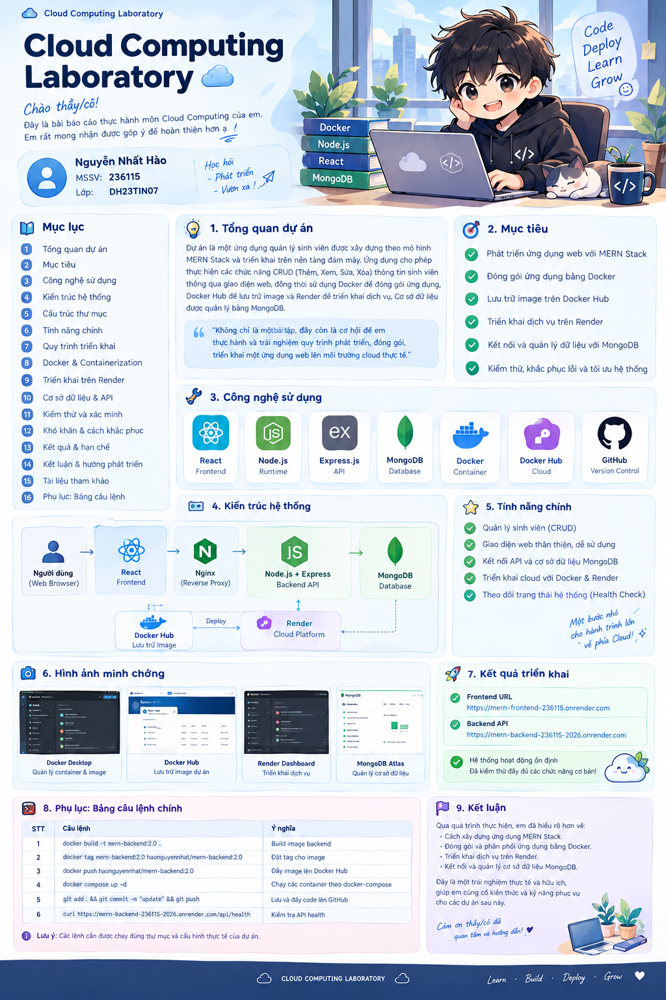
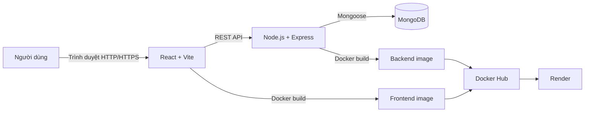

# Cloud Computing Laboratory
Student Name: Nguyen Nhat Hao
Student ID: 236115
Class: DH23TIN07

<div align="center">

# ☁️ CLOUD COMPUTING LABORATORY

### Báo cáo thực hành — Xây dựng và triển khai ứng dụng MERN Stack

<p>
  
  
  
</p>

<p><em>Học hỏi · Xây dựng · Đóng gói · Triển khai</em></p>

</div>

---

## 👨‍🎓 Thông tin sinh viên

<table>
  <tr>
    <td align="center" width="25%">
      
    </td>
    <td>
      <h3>NGUYỄN NHẤT HÀO</h3>
      <p><strong>MSSV:</strong> 236115</p>
      <p><strong>Lớp:</strong> DH23TIN07</p>
      <p><strong>Môn học:</strong> Điện toán đám mây (Cloud Computing)</p>
    </td>
  </tr>
</table>

> **Lời mở đầu:** Báo cáo trình bày quá trình xây dựng ứng dụng quản lý sinh viên theo mô hình MERN Stack, đóng gói bằng Docker, lưu trữ image trên Docker Hub và triển khai dịch vụ trên Render. Nội dung tập trung vào quy trình thực hiện, cấu hình, kiểm thử và những vấn đề gặp phải trong quá trình triển khai.





## 📚 Mục lục

1. [Tổng quan dự án](#-1-tổng-quan-dự-án)
2. [Mục tiêu thực hiện](#-2-mục-tiêu-thực-hiện)
3. [Công nghệ sử dụng](#-3-công-nghệ-sử-dụng)
4. [Kiến trúc hệ thống](#-4-kiến-trúc-hệ-thống)
5. [Cấu trúc thư mục](#-5-cấu-trúc-thư-mục)
6. [Chức năng chính](#-6-chức-năng-chính)
7. [Cài đặt và chạy ở môi trường local](#-7-cài-đặt-và-chạy-ở-môi-trường-local)
8. [Docker và Docker Hub](#-8-docker-và-docker-hub)
9. [Triển khai trên Render](#-9-triển-khai-trên-render)
10. [API và kiểm thử](#-10-api-và-kiểm-thử)
11. [Vấn đề gặp phải và hướng xử lý](#-11-vấn-đề-gặp-phải-và-hướng-xử-lý)
12. [Kết quả và hạn chế](#-12-kết-quả-và-hạn-chế)
13. [Kết luận và hướng phát triển](#-13-kết-luận-và-hướng-phát-triển)
14. [Tài liệu tham khảo](#-14-tài-liệu-tham-khảo)
15. [Phụ lục: Bảng câu lệnh](#-15-phụ-lục-bảng-câu-lệnh)

---

## ☁️ 1. Tổng quan dự án

Dự án xây dựng một ứng dụng web quản lý sinh viên theo mô hình **MERN Stack**. Giao diện web cho phép người dùng thao tác với dữ liệu sinh viên thông qua API do backend cung cấp. Backend sử dụng Node.js và Express để xử lý yêu cầu, trong khi MongoDB được sử dụng làm cơ sở dữ liệu.

Sau khi hoàn thiện ứng dụng, frontend và backend được đóng gói thành Docker image. Các image có thể được đẩy lên Docker Hub để lưu trữ và sử dụng trong quá trình triển khai. Render được sử dụng làm nền tảng chạy dịch vụ web trên môi trường đám mây.

### 📌 Thông tin dự án

| Hạng mục | Nội dung |
|---|---|
| Tên dự án | Cloud Computing Laboratory — MERN Demo |
| Loại ứng dụng | Web quản lý sinh viên |
| Frontend | React và Vite |
| Backend | Node.js, Express.js |
| Cơ sở dữ liệu | MongoDB, truy cập thông qua Mongoose |
| Đóng gói | Docker |
| Lưu trữ image | Docker Hub |
| Triển khai | Render |
| Quản lý mã nguồn | Git và GitHub |

## 🎯 2. Mục tiêu thực hiện

- Xây dựng ứng dụng web theo kiến trúc frontend — backend — database.
- Thiết kế API để thực hiện các thao tác CRUD đối với dữ liệu sinh viên.
- Sử dụng biến môi trường để quản lý cấu hình và thông tin kết nối.
- Đóng gói ứng dụng thành Docker image, phân biệt phiên bản bằng tag.
- Đẩy và lấy image từ Docker Hub.
- Triển khai dịch vụ trên Render, cấu hình URL và kiểm tra khả năng truy cập.
- Thực hành kiểm thử API, đọc log và khắc phục lỗi khi triển khai.
- Làm quen với quy trình cập nhật phiên bản và triển khai lại ứng dụng.

## 🧰 3. Công nghệ sử dụng

<div align="center">

| Công nghệ | Vai trò |
|---|---|
|  | Xây dựng giao diện người dùng |
|  | Chạy môi trường phát triển và build frontend |
|  | Môi trường chạy JavaScript phía server |
|  | Xây dựng API backend |
|  | Lưu trữ dữ liệu |
|  | Đóng gói và chạy container |
|  | Lưu trữ Docker image |
|  | Triển khai ứng dụng trên cloud |
|  | Quản lý mã nguồn |

</div>

## 🏗️ 4. Kiến trúc hệ thống



### Mô tả các thành phần

1. **Frontend:** Hiển thị giao diện và gửi yêu cầu đến backend thông qua HTTP API.
2. **Backend:** Tiếp nhận yêu cầu, kiểm tra dữ liệu, thực hiện nghiệp vụ và trả kết quả JSON.
3. **MongoDB:** Lưu trữ dữ liệu sinh viên; backend kết nối thông qua Mongoose.
4. **Docker:** Đóng gói ứng dụng và các thành phần cần thiết thành image.
5. **Docker Hub:** Lưu trữ image để có thể tải xuống tại môi trường triển khai.
6. **Render:** Chạy dịch vụ frontend/backend theo cấu hình triển khai của dự án.

> **Lưu ý về reverse proxy:** Nếu frontend được cấu hình Nginx để chuyển tiếp đường dẫn `/api/` sang backend, cần kiểm tra `proxy_pass` và URL backend thực tế. Không sử dụng tên miền mẫu trong cấu hình production.

## 📁 5. Cấu trúc thư mục

Cấu trúc tham khảo của repository:

```text
cloud-lab/
├── docker-compose.hub.yml
└── mern-demo/
    ├── docker-compose.yml
    ├── .env
    ├── client/
    │   ├── Dockerfile
    │   ├── nginx.conf
    │   ├── package.json
    │   └── src/
    └── server/
        ├── Dockerfile
        ├── package.json
        ├── server.js
        └── models/
```

**Ý nghĩa các thành phần chính**

| Tệp/thư mục | Chức năng |
|---|---|
| `client/` | Mã nguồn frontend React |
| `client/Dockerfile` | Build frontend và tạo image phục vụ bằng Nginx |
| `client/nginx.conf` | Cấu hình Nginx, định tuyến SPA và proxy API nếu được bật |
| `server/` | Mã nguồn backend Node.js/Express |
| `server/server.js` | Khởi tạo server và định nghĩa các endpoint |
| `server/models/` | Khai báo model dữ liệu Mongoose |
| `server/Dockerfile` | Định nghĩa cách build backend image |
| `docker-compose.yml` | Khởi chạy các dịch vụ theo cấu hình Compose |
| `docker-compose.hub.yml` | Cấu hình chạy image lấy từ registry, tùy nội dung tệp |
| `.env` | Lưu biến môi trường; không đưa secret lên GitHub |

## ⚙️ 6. Chức năng chính

- **Quản lý sinh viên (CRUD):** tạo mới, xem danh sách, cập nhật và xóa thông tin sinh viên qua API.
- **Giao tiếp frontend/backend:** frontend gửi request đến API và hiển thị dữ liệu nhận được.
- **Lưu trữ dữ liệu:** backend sử dụng Mongoose để thao tác với MongoDB.
- **Health check:** sử dụng endpoint kiểm tra sức khỏe server nếu endpoint đó được khai báo trong phiên bản backend đang triển khai.
- **Đóng gói container:** tạo image riêng cho frontend và backend.
- **Triển khai cloud:** sử dụng image hoặc cấu hình build để chạy ứng dụng trên Render.
- **Quản lý phiên bản:** đặt tag cho image để phân biệt các lần build, ví dụ `2.0`, `3.0` và `latest`.

## 💻 7. Cài đặt và chạy ở môi trường local

### 7.1. Điều kiện cần

- Git
- Node.js và npm
- Docker Desktop (nếu chạy bằng Docker)
- MongoDB hoặc một MongoDB connection string hợp lệ
- Tệp `.env` được cấu hình theo các biến mà backend thực sự sử dụng

### 7.2. Cấu hình biến môi trường

Tạo hoặc chỉnh sửa tệp `mern-demo/.env` theo yêu cầu trong mã nguồn. Ví dụ minh họa:

```env
PORT=5000
MONGODB_URI=your_mongodb_connection_string
```

Tên biến `MONGODB_URI` chỉ là ví dụ: hãy đối chiếu với `process.env...` trong mã nguồn backend và sử dụng đúng tên biến mà dự án đang đọc. Không commit thông tin xác thực, mật khẩu hoặc chuỗi kết nối thật lên repository.

### 7.3. Chạy backend

Mở terminal tại thư mục `mern-demo/server`:

```bash
npm install
npm start
```

Nếu `package.json` không khai báo script `start`, kiểm tra mục `scripts` và sử dụng lệnh tương ứng, chẳng hạn `npm run dev`.

### 7.4. Chạy frontend

Mở terminal khác tại `mern-demo/client`:

```bash
npm install
npm run dev
```

Vite sẽ hiển thị địa chỉ local trong terminal. Đảm bảo frontend đang gọi đúng backend API; nếu chạy hai dịch vụ riêng biệt, cần cấu hình URL API phù hợp và bật CORS khi cần.

### 7.5. Chạy bằng Docker Compose

Từ thư mục `mern-demo`, chạy:

```bash
docker compose up -d --build
docker compose ps
docker compose logs -f
```

Cấu hình Compose cần có các biến môi trường, cổng và địa chỉ kết nối database đúng với môi trường thực tế.

## 🐳 8. Docker và Docker Hub

### 8.1. Quy trình đóng gói

Quy trình tổng quát:

1. Kiểm tra mã nguồn và Dockerfile.
2. Build image frontend/backend.
3. Gắn tag theo phiên bản.
4. Đăng nhập Docker Hub.
5. Push image lên repository tương ứng.
6. Kiểm tra tag trên Docker Hub.
7. Cập nhật dịch vụ triển khai để sử dụng image mới.

### 8.2. Quy ước đặt tag

Ví dụ repository Docker Hub của dự án:

- Backend: `haonguyennhat/mern-backend`
- Frontend: `haonguyennhat/mern-frontend`

Nên sử dụng tag phiên bản rõ ràng như `2.0` hoặc `3.0` để dễ đối chiếu. Tag `latest` chỉ là một nhãn có thể thay đổi, không tự động đảm bảo môi trường đang chạy đã được cập nhật sang image mới.

### 8.3. Dockerfile frontend

Frontend có thể sử dụng multi-stage build: giai đoạn Node.js build ứng dụng React/Vite, sau đó sao chép thư mục build sang Nginx để phục vụ nội dung tĩnh. Cách làm này giúp image runtime gọn hơn so với việc mang toàn bộ môi trường build lên image cuối.

### 8.4. Dockerfile backend

Backend image cần cài đặt dependency, sao chép mã nguồn cần thiết và khởi chạy server theo script được khai báo trong `package.json`. Không sao chép tệp `.env` chứa secret vào image; hãy cấu hình biến môi trường ở nơi triển khai.

## ☁️ 9. Triển khai trên Render

### 9.1. Dịch vụ đã sử dụng

| Thành phần | URL |
|---|---|
| Frontend | [https://mern-frontend-236115.onrender.com](https://mern-frontend-236115.onrender.com) |
| Backend | [https://mern-backend-236115-2026.onrender.com](https://mern-backend-236115-2026.onrender.com) |

Các URL trên là địa chỉ đã dùng trong quá trình thực hiện; trạng thái truy cập và cấu hình có thể thay đổi theo dashboard của Render.

### 9.2. Các bước triển khai

1. Tạo hoặc mở Web Service trên Render.
2. Chọn cách triển khai tương ứng: kết nối repository hoặc sử dụng Docker image.
3. Cấu hình port và các biến môi trường cần thiết.
4. Thiết lập chuỗi kết nối MongoDB trong phần Environment.
5. Cấu hình frontend để gọi đúng API backend hoặc cấu hình Nginx reverse proxy.
6. Triển khai lại sau khi cập nhật image hoặc cấu hình.
7. Mở log của service để kiểm tra quá trình khởi động và lỗi runtime.
8. Kiểm thử các endpoint và chức năng từ trình duyệt.

### 9.3. Lưu ý khi cập nhật image

Sau khi push image mới lên Docker Hub, cần xác nhận dịch vụ Render đang sử dụng đúng repository và tag. Nếu dùng tag có thể thay đổi như `latest`, hãy thực hiện redeploy theo cấu hình của dịch vụ và kiểm tra log/image đang chạy. Không kết luận deploy thành công chỉ dựa trên việc lệnh `docker push` hoàn tất.

## 🔌 10. API và kiểm thử

Các endpoint dưới đây cần được đối chiếu với `server.js` của phiên bản đang chạy trước khi sử dụng trong báo cáo cuối cùng.

| Phương thức | Endpoint | Mục đích |
|---|---|---|
| `GET` | `/api/students` | Lấy danh sách sinh viên |
| `POST` | `/api/students` | Tạo sinh viên |
| `PUT` hoặc `PATCH` | `/api/students/:id` | Cập nhật sinh viên, tùy cách định nghĩa route |
| `DELETE` | `/api/students/:id` | Xóa sinh viên |
| `GET` | `/api/hello` | Endpoint kiểm tra/demo nếu được khai báo |
| `GET` | Endpoint health check đã cấu hình | Kiểm tra trạng thái server |

### Ví dụ kiểm thử bằng curl

```bash
curl -i https://mern-backend-236115-2026.onrender.com/api/students
```

Tạo sinh viên — điều chỉnh tên trường theo schema backend:

```bash
curl -i -X POST "https://mern-backend-236115-2026.onrender.com/api/students" \
  -H "Content-Type: application/json" \
  -d "{\"studentId\":\"sv003\",\"name\":\"Nguyen Van B\",\"email\":\"sv003@example.com\"}"
```

Nếu gửi yêu cầu tạo sinh viên qua frontend, hãy kiểm tra **Request URL** trong Developer Tools. API CRUD của dự án dùng đường dẫn `/api/students`; nếu request bị gửi đến `/students` hoặc frontend URL mà chưa có proxy tương ứng, request có thể nhận lỗi `404` hoặc `405`.

### Checklist kiểm thử

- [ ] Frontend tải được trên trình duyệt.
- [ ] Backend khởi động và log không có lỗi kết nối database.
- [ ] `GET /api/students` trả về response như mong đợi.
- [ ] `POST /api/students` tạo dữ liệu thành công.
- [ ] Chức năng cập nhật và xóa hoạt động đúng.
- [ ] Frontend gọi đúng base URL hoặc reverse proxy.
- [ ] Dữ liệu vẫn được lưu sau khi tải lại trang.
- [ ] Image/tag đang chạy trên Render đúng phiên bản mong muốn.

## 🧯 11. Vấn đề gặp phải và hướng xử lý

| Vấn đề | Nguyên nhân có thể | Hướng kiểm tra/xử lý |
|---|---|---|
| Frontend không lấy được danh sách | Sai API base URL hoặc backend chưa chạy | Kiểm tra Network, biến môi trường frontend và log backend |
| Request `POST /students` trả `405` | Gọi sai đường dẫn hoặc proxy chưa định tuyến POST | Kiểm tra URL request; đối chiếu route `/api/students` và `nginx.conf` |
| Frontend hiển thị lỗi kết nối | CORS, URL backend sai hoặc service đang ngủ/khởi động lại | Kiểm tra Console, Network và Render logs |
| Backend không kết nối MongoDB | Sai biến môi trường, URI hoặc quyền truy cập database | Kiểm tra tên biến được đọc trong mã nguồn và cấu hình database |
| Render vẫn chạy phiên bản cũ | Service chưa redeploy hoặc tag/image chưa cập nhật đúng | Kiểm tra tag Docker Hub, service config và deploy logs |
| Docker báo không tìm thấy Dockerfile | Chạy build tại sai thư mục hoặc thiếu `-f` | Chuyển đến thư mục chứa Dockerfile hoặc chỉ rõ đường dẫn Dockerfile |
| Push báo không tìm thấy tag | Image local chưa được gắn tag đúng repository | Dùng `docker images`, `docker tag` rồi push đúng tên đầy đủ |

## 📊 12. Kết quả và hạn chế

### Kết quả hướng tới/đã thực hành

- Xây dựng ứng dụng frontend/backend theo mô hình MERN.
- Thực hành các thao tác CRUD qua API quản lý sinh viên.
- Tạo Docker image cho các thành phần của ứng dụng.
- Thực hành gắn tag và push image lên Docker Hub.
- Triển khai dịch vụ frontend/backend trên Render.
- Làm quen với việc đọc log, kiểm tra HTTP status và xử lý lỗi cấu hình.

> Chỉ đánh dấu một chức năng là **hoàn thành** trong bản báo cáo nộp cuối cùng sau khi đã kiểm thử lại trên môi trường đang triển khai.

### Hạn chế

- Trạng thái của dịch vụ cloud có thể phụ thuộc cấu hình, giới hạn gói miễn phí và thời gian khởi động.
- Cấu hình URL API và reverse proxy cần đồng bộ giữa frontend, Nginx và backend.
- Cần bổ sung ảnh chụp màn hình thật từ Docker Desktop, Docker Hub, Render và ứng dụng sau khi kiểm thử.
- Cần hoàn thiện kiểm thử lỗi đầu vào, bảo mật API và xử lý ngoại lệ nếu mở rộng thành ứng dụng thực tế.

## 🚀 13. Kết luận và hướng phát triển

Qua dự án, sinh viên có cơ hội kết hợp kiến thức phát triển web với quy trình đóng gói và triển khai ứng dụng trên nền tảng đám mây. Quá trình thực hành giúp hiểu rõ hơn vai trò của frontend, backend, database, container image và nền tảng triển khai.

Trong tương lai, dự án có thể được phát triển thêm theo các hướng:

- Bổ sung xác thực và phân quyền người dùng.
- Tăng cường validate dữ liệu và xử lý lỗi API.
- Hoàn thiện giao diện, phân trang, tìm kiếm và lọc sinh viên.
- Bổ sung logging, health check và kiểm thử tự động.
- Tự động hóa quy trình CI/CD sau khi push mã nguồn hoặc phát hành image.
- Tách cấu hình development/production và quản lý secret an toàn hơn.

## 📖 14. Tài liệu tham khảo

- [React Documentation](https://react.dev/)
- [Vite Documentation](https://vite.dev/guide/)
- [Node.js Documentation](https://nodejs.org/docs/latest/api/)
- [Express Documentation](https://expressjs.com/)
- [MongoDB Documentation](https://www.mongodb.com/docs/)
- [Docker Documentation](https://docs.docker.com/)
- [Docker Hub](https://hub.docker.com/)
- [Render Documentation](https://render.com/docs)
- [GitHub Docs](https://docs.github.com/)

## 🧾 15. Phụ lục: Bảng câu lệnh

> Chạy lệnh trong đúng thư mục dự án. Tên tag và đường dẫn có thể cần điều chỉnh theo trạng thái thực tế.

| STT | Câu lệnh | Ý nghĩa |
|---:|---|---|
| 1 | `git clone <repository-url>` | Tải repository về máy |
| 2 | `cd mern-demo` | Đi vào thư mục dự án |
| 3 | `npm install` | Cài dependency của package hiện tại |
| 4 | `npm run dev` | Chạy chế độ phát triển nếu script được khai báo |
| 5 | `npm start` | Khởi chạy ứng dụng theo script `start` |
| 6 | `docker compose up -d --build` | Build image và chạy các dịch vụ trong Compose |
| 7 | `docker compose ps` | Xem trạng thái container Compose |
| 8 | `docker compose logs -f` | Theo dõi log các dịch vụ |
| 9 | `docker ps` | Liệt kê container đang chạy |
| 10 | `docker images` | Liệt kê image local |
| 11 | `docker build -t mern-backend:2.0 .` | Build backend image khi đang ở thư mục chứa Dockerfile backend |
| 12 | `docker build -t mern-frontend:3.0 .` | Build frontend image khi đang ở thư mục chứa Dockerfile frontend |
| 13 | `docker tag mern-backend:2.0 haonguyennhat/mern-backend:2.0` | Gắn tag Docker Hub cho backend image |
| 14 | `docker tag mern-frontend:3.0 haonguyennhat/mern-frontend:3.0` | Gắn tag Docker Hub cho frontend image |
| 15 | `docker login` | Đăng nhập Docker Hub |
| 16 | `docker push haonguyennhat/mern-backend:2.0` | Push backend image lên Docker Hub |
| 17 | `docker push haonguyennhat/mern-frontend:3.0` | Push frontend image lên Docker Hub |
| 18 | `docker pull haonguyennhat/mern-backend:2.0` | Tải backend image từ Docker Hub |
| 19 | `docker pull haonguyennhat/mern-frontend:3.0` | Tải frontend image từ Docker Hub |
| 20 | `docker tag mern-frontend:3.0 haonguyennhat/mern-frontend:latest` | Gắn thêm tag `latest` cho frontend image |
| 21 | `docker push haonguyennhat/mern-frontend:latest` | Push tag `latest` lên Docker Hub |
| 22 | `curl -i https://mern-backend-236115-2026.onrender.com/api/students` | Kiểm tra API danh sách sinh viên |
| 23 | `git status` | Kiểm tra thay đổi trong repository |
| 24 | `git add .` | Đưa các thay đổi vào staging |
| 25 | `git commit -m "Update README"` | Tạo commit |
| 26 | `git push` | Đẩy commit lên remote repository |

---

<div align="center">

### 💙 Cảm ơn thầy/cô đã theo dõi báo cáo!

*Learn · Build · Deploy · Grow*

**Nguyễn Nhất Hào · 236115 · DH23TIN07**

</div>
'''

